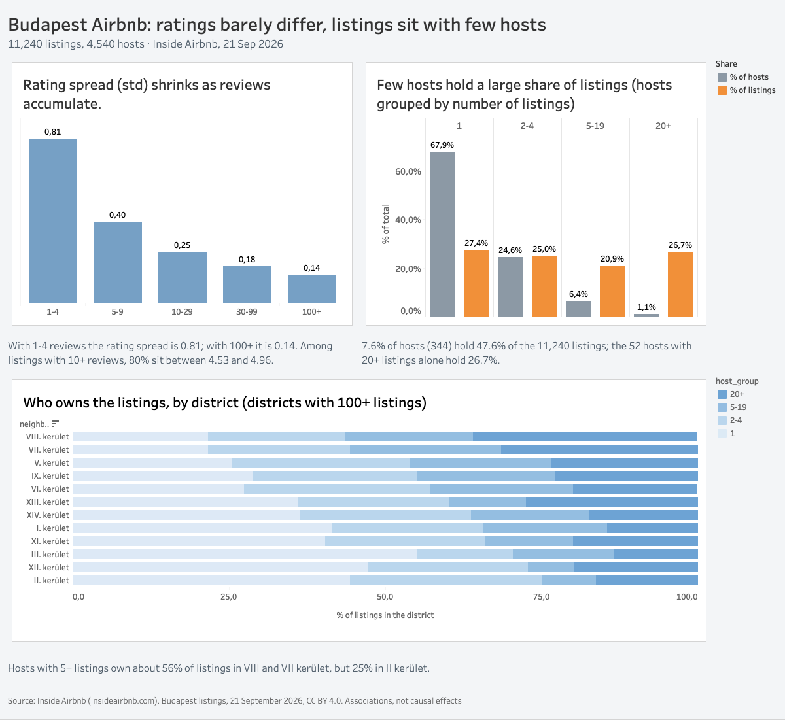
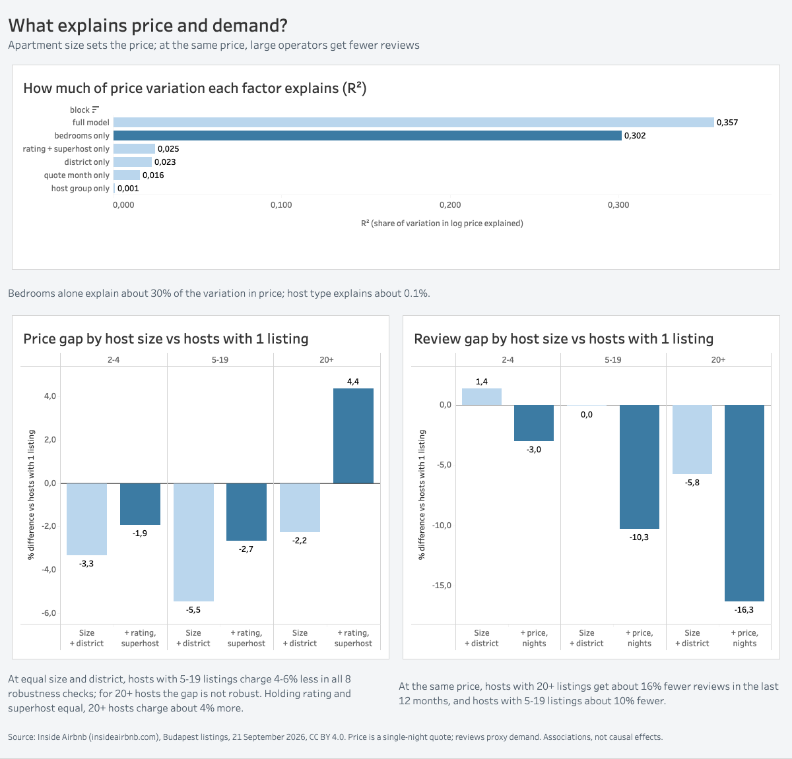

# Budapest Airbnb: what explains price and demand when ratings are almost all the same?

An exploratory analysis of 11,240 Airbnb listings in Budapest. Ratings are squeezed against the top of the scale and tell guests little, so what actually explains differences in price and demand: apartment size, location, or who the host is?

**Interactive dashboards:** [Tableau Public](https://public.tableau.com/app/profile/mikita.mayorau/viz/AirBnB-D1/Dashboard1)

## Data

- **Source:** Inside Airbnb, Budapest, detailed listings file (snapshot labelled 21 September 2026), insideairbnb.com/get-the-data. 11,240 listings, 4,540 hosts, 90 columns.
- **License:** CC BY 4.0. This project contains data from Inside Airbnb.
- **Data dictionary:** the official Inside Airbnb dictionary (v4.7). 15 columns in the file, including `estimated_occupancy_l365d` and `estimated_revenue_l365d`, are not described in it, so they are used with caveats (see Limitations).

## Approach

1. **Audit and cleaning.** Every decision is recorded with its reason and effect in a decision log (D1-D26) in the notebook.
2. **Hypotheses written before any model** (H0-H9), with a rule for what would refute each one.
3. **Samples.** Price and demand: entire homes with a price, minimum stay under 28 nights, price at or below the 99th percentile (about 475,600 HUF): 8,856 listings. Rating analysis: listings with 10+ reviews and a rating: 7,207.
4. **Host size** is grouped as 1 / 2-4 / 5-19 / 20+ listings (entire-home count for price and demand, total count for market structure).
5. **Models.** OLS with robust (HC3) standard errors for log price and log(1 + reviews in the last 12 months) as a demand proxy, with controls added step by step (bedrooms, district, quote month, rating, Superhost, price, minimum nights). Poisson regression on review counts as a check. Effects are reported as percentage differences (exp(b) - 1) with 95% confidence intervals.
6. **Robustness.** The main results were re-estimated under 8 alternative sample and definition choices.

## Key findings

**1. Ratings are compressed, and with few reviews they are mostly noise.**
Among listings with 10+ reviews, 80% sit between 4.53 and 4.96. The spread of ratings falls from 0.81 (1-4 reviews) to 0.14 (100+ reviews), and the share of perfect 5.0 ratings falls from 55% to 1%.
*Caveat:* ratings clustered near the ceiling make correlations look weaker than the true importance of quality.

**2. The market is concentrated in a few hands.**
7.6% of hosts (344) hold 47.6% of the 11,240 listings; the 52 hosts with 20+ listings alone hold 26.7%. Across the 12 districts with 100+ listings, the share held by hosts with 5+ listings ranges from 25% to 56%.
*Caveat:* host size is counted within Budapest only.

**3. Apartment size, not host type, explains price.**
Bedrooms alone explain about 30% of the variation in log price, district about 2%, host type about 0.1% (stable across 8 sample choices). Median prices of private hosts and large operators differ by less than 3%. At equal size and district, hosts with 5-19 listings charge 4-6% less in all 8 variants; no robust gap was found for hosts with 20+ listings.
*Caveat:* price is a single-night quote that may include a discount.

**4. Large operators have lower ratings and fewer Superhosts.**
At equal size, district and number of reviews, hosts with 20+ listings have ratings 0.15 points lower and 34 percentage points fewer Superhosts than hosts with one apartment (robust in 8 of 8 variants: 0.06-0.16 points and 27-34 pp).
*Caveat:* association only. The Superhost badge depends on past-year rating, completed stays, cancellations and response rate.

**5. At the same price, large operators get fewer reviews.**
Holding price, size, district and minimum nights equal, hosts with 20+ listings get about 16% fewer reviews in the last 12 months (16-20% across variants) and hosts with 5-19 listings about 10% fewer (9-13%). A 10% higher price goes with about 7.6% fewer reviews (6.5-8.0%).
*Caveat:* reviews are a proxy for demand, not bookings, and price may itself be a channel through which host type matters.

### What did not hold up
- I expected operators to have higher demand than private hosts; at equal price they have lower demand.
- I expected district to be a major price driver; it explains only about 2% of price variation.
- I expected "value" and "accuracy" to be the most spread-out sub-scores; cleanliness varies most and communication least.
- "Hosts with 20+ listings charge less at equal size and district" looked plausible at first but is not robust.

## Hypotheses and outcomes

| # | Hypothesis | Outcome |
|---|---|---|
| H0 | Missing prices are not random | Supported: 94% of missing prices belong to listings from the previous scrape |
| H1 | With 10+ reviews ratings are compressed; with few reviews they are noise | Supported |
| H2 | Rating and Superhost barely relate to price and demand once size and district are equal | Not supported as stated: rating goes with +22% price and +45% reviews (see Limitations on circularity); the Superhost effect is not robust |
| H3 | Sub-scores differ in spread and in how they relate to price and demand | Partly supported: spread differs (cleanliness most, communication least); the link with price and demand was not tested |
| H4 | Hosts are concentrated, with differences by district | Supported |
| H5 | Large operators have lower ratings and fewer Superhosts | Supported, robust |
| H6 | Average prices look equal across host types but differ within segments | Partly supported (composition effect, not a clean Simpson reversal) |
| H7 | Size and district explain most of the price variation | Partly supported: size yes, district no |
| H8 | Operators' demand differs from private hosts' at equal size, district and price | Partly supported, opposite direction to the initial expectation |
| H9 | Higher price goes with lower demand | Supported |
| H10 (exploratory) | Listings without reviews in the last 12 months are not random | Supported in a first descriptive look |

## Robustness

| Finding | Holds across 8 variants? |
|---|---|
| 20+ hosts: lower rating and fewer Superhosts | Yes (8 of 8) |
| 5-19 hosts charge 4-6% less at equal size and district | Yes (8 of 8) |
| 20+ hosts charge less at equal size and district | No (-2.2%, CI includes 0, sign varies) |
| 20+ hosts charge more at equal rating and Superhost | 7 of 8; disappears when ratings based on few reviews are included |
| Higher rating goes with higher price | Sign yes; size +8% to +28% depending on the sample |
| Bedrooms dominate price variation | Yes (R2 0.26-0.32 vs district 0.02-0.06) |
| At equal price, 20+ and 5-19 hosts get fewer reviews | Yes (8 of 8) |
| 20+ review gap without holding price | Negative in all variants, CI excludes 0 in only 3 of 8 |
| Higher price goes with fewer reviews | Yes (8 of 8; -6.5% to -8.0% per +10% price) |

The 8 variants overlap heavily (mostly the same listings), so this table describes sensitivity, not independent confirmations.

## Limitations

- **One snapshot in time.** No before/after comparisons within a listing.
- **Price is a single-night quote** for a specific check-in date (mostly September-October 2026), and about 16% of quotes include a discount. It is not an annual average.
- **Demand is proxied by reviews in the last 12 months**, not by bookings. `estimated_occupancy_l365d` is not documented in the data dictionary; its behaviour (0.90 correlation with reviews, a cap at 255 nights) suggests it is derived from reviews.
- **Ratings are compressed** near the ceiling, which weakens correlations. Ratings and reviews come from the same reviews.
- **The Superhost badge** is awarded from past-year rating, completed stays, cancellations and response rate, so its link with demand is partly mechanical. For price, its difference changes sign with the choice of controls and is concentrated among single-listing hosts, so no robust effect is claimed.
- **Host size is counted within Budapest only.** A "private host" here means one listing in Budapest.
- **Coordinates are anonymised**, so district borders are approximate.
- **Associations, not causal effects.** Many models were run; read the pattern across variants rather than single results.

## Repository

data/ Inside Airbnb listings file (CC BY 4.0)
notebooks/ 01_analysis.ipynb - full analysis with decision log
outputs/ figures; outputs/tableau holds the CSV files behind the dashboards
README.md
requirements.txt

## How to reproduce

python3 -m venv env
source env/bin/activate
pip install -r requirements.txt
jupyter lab

Open `notebooks/01_analysis.ipynb` and run Restart and Run All. The notebook reads `../data/budapest_listings.csv.gz`.

## Author

Mikita Mayorau, [LinkedIn](https://www.linkedin.com/in/mikita-mayorau/)

*Contains data from Inside Airbnb (insideairbnb.com), licensed under CC BY 4.0.*